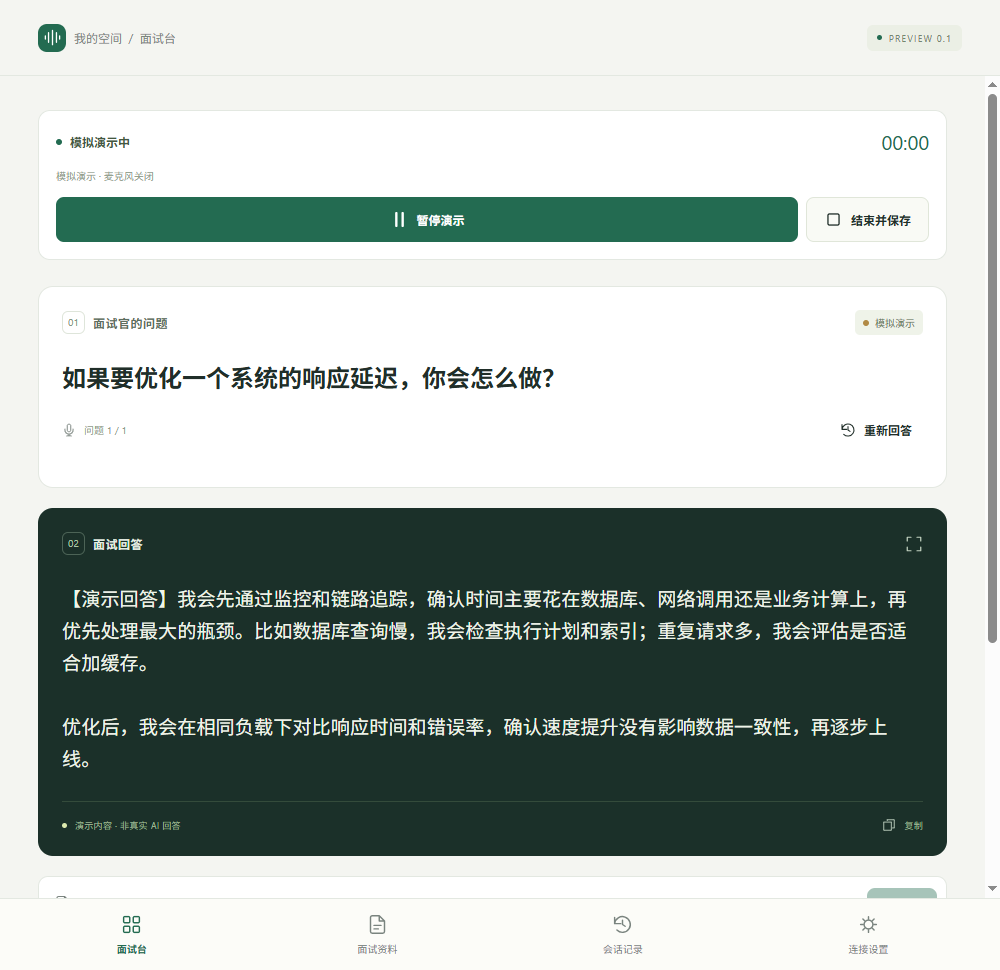

# OfferPaw · AI Interview Companion

[中文说明](README.zh-CN.md) · [Run the demo](#try-the-scripted-demo) · [MIT License](LICENSE)

OfferPaw (Offer汪) puts a technical interview question, its transcript, and a streamed reference answer in one workspace. Use it to rehearse technical interviews or in sessions where participants agree to recording and assistance. The interface is primarily Chinese and answer generation supports Chinese and English.



*Actual web demo. The question, transcript and answer are preset. The demo needs no microphone or API key.*

[v0.1.0-alpha.1](https://github.com/JadoreSamoyed/offerpaw/releases/tag/v0.1.0-alpha.1) is a source preview for self-hosting. Live speech needs separate configuration. The release ships source code and setup instructions.

## Try the scripted demo

Install Git and Node.js 24 (with npm), then run:

```sh
git clone https://github.com/JadoreSamoyed/offerpaw.git
cd offerpaw
npm ci
npm run demo
```

Open **http://localhost:8081** and select **模拟演示** (scripted demo). The example question and reference answer appear automatically. The backend uses localhost port 8787.

The demo disables live provider credentials for its process and uses preset questions and answers. It does not use the microphone, download speech models or call an LLM. Demo timing is not a live AI performance measurement. Stop the two development services with Ctrl+C.

The demo starts with empty profile/history and no token. It does not read, overwrite or clear data from previous installations. Demo edits and history remain in page memory and disappear on refresh; connection settings are fixed to localhost. Restart the app with `npm run dev` to use your normal saved workspace.

To check the demo transport without opening the UI:

```sh
npm run demo:smoke
```

## What is implemented

- A React Native / Expo app for web, Android and iOS, with native Kotlin and Swift PCM recording modules.
- Streaming question/answer sessions, interruption handling and local history.
- PDF, DOCX and TXT resume-text extraction with upload limits and isolated parsing.
- Chinese/English local ASR, optional cloud ASR adapters and user-configured compatible LLM endpoints.
- Speaker-aware question handling, manual role controls, and explicit unknown-speaker states.
- Session-scoped answer preparation and caching, with cancellation when a transcript is revised.

The default profile is empty. [The example profile](examples/profile.json) is entirely fictional and is not loaded automatically.

## Live speech setup

1. Copy `services/server/.env.example` to `services/server/.env` and configure your own LLM endpoint, key and model. A hosted LLM may charge for usage.
2. Follow [local ASR setup](docs/asr-local.md) if using the local recognizer. Installing its runtime/models is optional and separate from the demo.
3. Run `npm run dev`. Open the app's connection settings and provide your own backend URL. Native phones cannot reach the computer through `localhost`.
4. For a live session, enable the microphone and use the app's voice enrollment or manual speaker controls.

The server defaults to loopback. Remote use requires a deployment you configure, HTTPS/WSS, an access token and suitable browser origins. Personal production endpoints, account bindings, signing files and existing installation packages are not included.

## Development

For bug reports and code changes, see [Contributing](CONTRIBUTING.md).

```sh
npm run typecheck
npm test
npm run demo:smoke
npm run build
```

`npm run build` builds the Node service and exports the web app; it does not generate an APK or IPA. Native audio requires a development build containing the local module, not Expo Go. Configure your own Android/iOS identifiers and signing before making a mobile release.

```text
apps/mobile/       app, storage and audio modules
services/server/   WebSocket protocol, answer pipeline, ASR adapters, resume extraction
services/asr-local/ optional local speech runtime and public-model manifests
scripts/           development, demo and setup commands
```

## Current validation and limits

Type checking and mock-based unit/integration tests have been run on the source export. The local demo smoke test checks an actual localhost WebSocket session with preset output. See [validation details](docs/validation.md) for the recorded results.

This export has not been freshly validated on Android/iOS devices, against a live LLM, or against real speech models. No production availability, recognition accuracy or latency target is claimed. Short utterances, overlapping speakers, noisy rooms and network changes still need device testing. Sessions currently use a shared server access token; there is no multi-user account system or cloud history sync.

Live mode sends audio to the selected ASR service and questions/profile text to the selected answer provider. Recordings, history and speaker profiles are stored on the user's device; storage limits and deletion behavior differ between native and web. Use fictional data for public demos.

## License and third-party components

Known Expo development-tool dependency advisories and the checks performed for this preview are documented in the [dependency audit](docs/dependency-audit.md).

OfferPaw source is licensed under the [MIT License](LICENSE). Existing file-level notices are preserved; dependencies and optional speech models retain their own licenses. Model weights are not included. See [third-party component notes](THIRD_PARTY.md) before distributing models or native builds.
